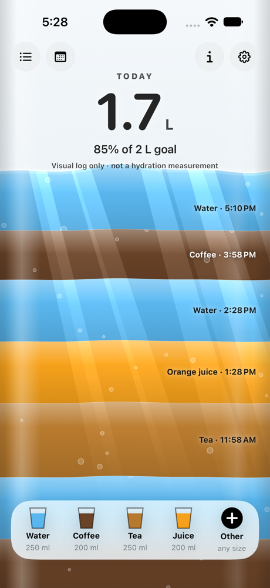

<div align="center">

# Siprup 💧

**A playful hydration log for iOS where the whole screen is the side of a glass.**

Every drink you log pours in as its own coloured band, with caustic light, rising bubbles, a meniscus that tilts with your phone, and a foamy head on beer.




</div>

## Stack
Only Apple's built-in frameworks, so there are no third-party dependencies:
- **SwiftUI** `Canvas`/`TimelineView` draws the liquid: waves, meniscus, bubbles that catch light, wall bubbles, fizz, beer foam
- A **Metal** `layerEffect` shader (`LiquidShaders.metal`) adds caustic light through each drink's colour and underwater refraction. It needs Apple's Metal Toolchain: `xcodebuild -downloadComponent MetalToolchain`
- **SwiftData** for local drink history, drink types and per-day goals
- **Swift Charts** for the 7-day history chart
- **UserNotifications** for gentle reminders (quiet hours, pause, a "Pause for today" action, and no reminders once the goal is met)
- **CoreMotion** to tilt and slosh the liquid (it stays still in the simulator and with Reduce Motion on)
- **XcodeGen** generates `Siprup.xcodeproj` from `project.yml`

## Run
```bash
xcodegen generate
open Siprup.xcodeproj   # iOS 17+, iPhone simulator
```
Debug launch arguments:
- `-SiprupInMemory` uses a throwaway store
- `-SiprupDemoData` seeds today plus 7 past days
- `-SiprupOpenSheet add|today|history|settings` opens a screen at launch

## Tests
```bash
xcodebuild test -project Siprup.xcodeproj -scheme Siprup -destination 'platform=iOS Simulator,name=iPhone 18 Pro'
```
These cover the day-reset maths, unit conversion, nutrition sums, reminder scheduling, text contrast and dock pinning.

## Dock
The home screen dock holds four pinned drinks, each logged in one tap at its quick-add size (with Undo), plus **More** for any drink or size. To change the pins, press and hold a dock drink or go to Settings → Dock. Set the quick-add size in Settings → Drink types.

## License

[MIT](LICENSE) © Kenneth Gomes
